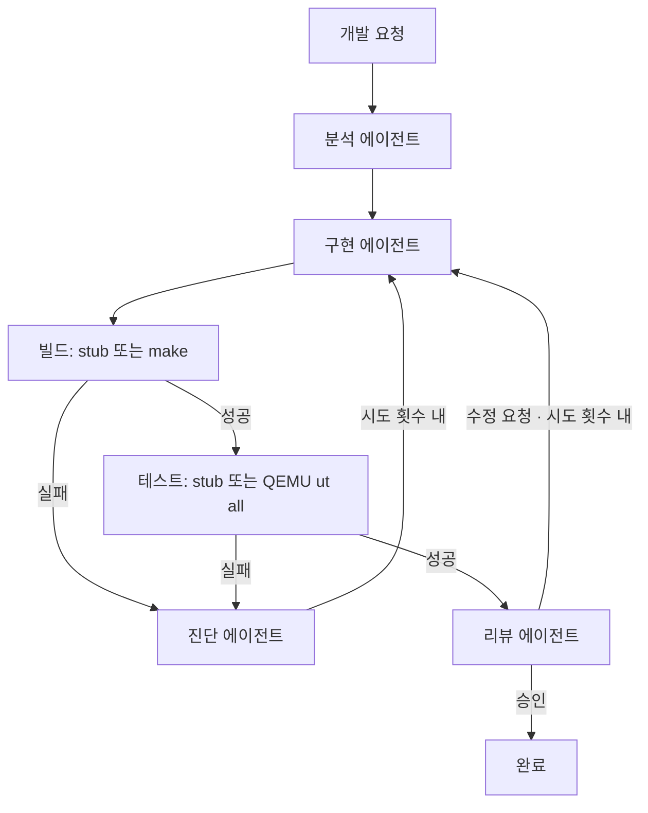

# LK AX orchestration prototype

LK 개발 요청을 역할별 에이전트에 전달하고 빌드·보드 테스트 결과에 따라 수정과 리뷰를 반복하는 Python 프로토타입입니다. Python 3.10 이상이며 외부 패키지가 필요 없습니다.

## 실행

```bash
python3 -m lk_ax "UART 초기화 실패 분석 및 수정"
python3 -m lk_ax "UART 초기화 실패 분석 및 수정" --scenario build-fails-once
python3 -m lk_ax "UART 초기화 실패 분석 및 수정" --scenario test-fails-once
python3 -m lk_ax "UART 초기화 실패 분석 및 수정" --scenario always-fail --max-attempts 2
```

기본 실행은 결정적 데모 에이전트와 stub 검증을 사용합니다. LLM 호출이나 실제 소스 수정은 하지 않습니다. `--validation qemu`를 선택하면 실제 LK 빌드와 QEMU unit test를 수행합니다. 데모 에이전트는 이 모드에서도 소스를 수정하지 않으며 실제 구현 에이전트는 별도로 연결해야 합니다.

## 실제 빌드와 QEMU 테스트

```bash
python3 -m lk_ax "LK ARM64 QEMU 빌드 및 전체 unit test 검증" \
  --validation qemu --lk-root ../lk
```

현재 실제 검증 타깃은 `qemu-virt-arm64-test`입니다. `make`, `aarch64-linux-gnu-gcc` 및 관련 binutils, `qemu-system-aarch64`가 PATH에 필요합니다. LK 경로 기본값은 이 저장소와 같은 부모 디렉터리의 `lk`입니다.

빌드는 GCC, DEBUG=2, UBSAN=0, miniheap, local.mk 무시 설정을 명시합니다. 산출물은 `runs/<id>/build/build-qemu-virt-arm64-test/`에 저장합니다. 기존 LK 소스와 빌드 디렉터리를 변경하지 않고 현재 소스를 빌드합니다. 재시도는 같은 실행의 빌드 디렉터리를 재사용합니다.

Linux용 cross GCC를 bare-metal LK 빌드에 사용하므로 컴파일러 호출에 `-Ulinux -U__linux -U__linux__ -mno-outline-atomics`를 적용합니다. Linux predefined macro 때문에 dlmalloc이 게스트에서 지원하지 않는 `mremap` 경로를 선택하는 문제와 libgcc의 Linux `__getauxval` 의존성을 방지합니다. 이 설정도 실행 보고서에 기록합니다.

QEMU는 ARM64 virt / GICv2 / cortex-a76 / RAM 512MB / CPU 4개로 생성된 `lk.elf`를 부팅합니다. `lk.autorun=sleep+5;ut+all;poweroff`로 전체 unit test를 실행하고 종료합니다. 네트워크 장치와 모니터는 비활성화합니다. 성공 조건은 QEMU 종료 코드 0, LK 부팅 메시지, 전체 CASES 수가 0보다 크고 SUCCESS와 같으며 FAILED=0, 전체 테스트 성공 메시지입니다. 게스트 실패 메시지나 timeout은 실패로 판정합니다.

`--jobs`와 `--cpus` 기본값은 4, `--build-timeout`은 300초, `--test-timeout`은 90초입니다. `--toolchain-prefix`로 GCC toolchain prefix를 변경할 수 있습니다. timeout 시 실행 프로세스 그룹을 종료합니다. 실패 로그를 진단·구현 에이전트에 전달하고 기존 재시도 정책을 적용합니다. 실제 모드에서 stub 실패 시나리오는 사용할 수 없습니다.

실행 디렉터리에 `build-attempt-N.log`, `test-attempt-N.log`를 저장합니다. 이벤트와 보고서에는 명령, 종료 코드, timeout 여부, 경과 시간, 산출물 경로, 테스트 case 수 및 로그 마지막 12,000자를 기록합니다. 에이전트 context의 `validation_environment`에서 소스·빌드 경로와 toolchain 설정을 확인할 수 있습니다.

각 에이전트는 자신의 실행 시작과 결과를 콘솔에 출력합니다. 외부 에이전트의 stderr 로그도 콘솔로 전달하며 stdout은 JSON 응답 전용으로 유지합니다.



실패나 리뷰 수정 요청은 `--max-attempts`까지 반복합니다. 한도 초과 및 에이전트 오류는 실패로 종료합니다. 종료 코드는 완료 시 0, 실패 시 1입니다.

## 실제 에이전트 연결

`--agent-config agents.json`으로 각 역할을 외부 에이전트 프로세스에 연결할 수 있습니다. 명령은 shell 문자열 대신 인자 배열을 사용합니다. 실행 디렉터리는 현재 디렉터리이며 각 호출은 별도 프로세스입니다. 역할 간 상태는 context로 전달됩니다.

```json
{
  "analyst": ["python3", "my_agent.py", "--role", "analyst"],
  "implementer": ["python3", "my_agent.py", "--role", "implementer"],
  "diagnostician": ["python3", "my_agent.py", "--role", "diagnostician"],
  "reviewer": ["python3", "my_agent.py", "--role", "reviewer"]
}
```

각 프로세스는 stdin으로 `{"role": "...", "context": {...}}` JSON을 받고 stdout으로 JSON 객체 하나를 반환해야 합니다. 로그는 stderr로 출력합니다. 모든 응답에 문자열 `summary`가 필요하며 reviewer에는 boolean `approved`가 추가로 필요합니다. 나머지 필드는 자유롭게 추가할 수 있습니다. Context에는 요청, 분석, 구현 결과, 검증 로그, 진단, 시도 횟수가 전달됩니다. 외부 에이전트의 모델·인증·프롬프트·권한은 해당 프로세스에서 설정합니다. 이 런타임은 프로세스 sandbox를 제공하지 않습니다.

## 실행 기록과 확장 지점

각 실행은 `runs/<id>/events.jsonl`에 단계별 이벤트를, `report.json`에 최종 상태와 context를 저장합니다. `--output`은 새 디렉터리를 지정해야 하므로 기존 실행 기록을 덮어쓰지 않습니다.

`CommandAgent`는 실제 에이전트 연결 지점이며 `QemuChecks`는 실제 ARM64 빌드·QEMU 검증을 수행합니다. `StubChecks`는 오케스트레이션 데모에 사용합니다. 현재는 순차 실행과 제한된 재시도만 지원하며 중단 후 재개, 병렬 실행, 내장 패치 적용, 실제 보드 플래싱은 포함하지 않습니다.

검증: `python3 -m unittest discover -s tests -v`
